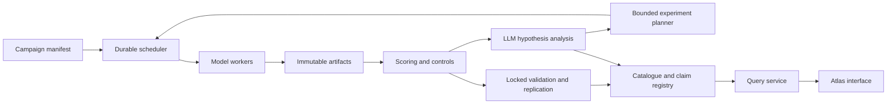

# Automated neuron engineering: system design

Design version 0.1 · 2026-11-02 · Proposed implementation, no real runs yet.

## Product objective

Find interventions with measurable, repeatable effects in small language models and catalogue the supporting evidence. A catalogue entry identifies a component in an exact model checkpoint; each behavior claim additionally identifies an intervention, dose, token policy, task distribution and evaluation. One neuron may support multiple competing interpretations. Null and failed results remain searchable.

The system can run unattended within a declared campaign budget. Human input sets objectives, allowable models, task datasets, spending and promotion thresholds before a campaign. Manual approval is optional per campaign for routine jobs, while automatic stopping rules enforce the configured limits. The pipeline must not fabricate success when a model lacks the task capability.

## Staged pipeline

| Stage | Work | Durable output and gate |
| --- | --- | --- |
| Register | Resolve immutable weights/tokenizer, template, adapter and dataset splits | Model fingerprint; licensing and acquisition metadata |
| Conformance | Assert hook sites, zero dose, batching, masks, cached decode and intervention equivalence | Backend test report; block invalid adapters |
| Calibrate | Residual norms and activation distributions over a versioned corpus | Calibration with position policy, quantiles and sample counts |
| Screen | Seeded neuron subset and cheap teacher-forced changes; natural activation contrasts | Candidate rankings with null controls; discovery split only |
| Sweep | Both signs, dose ladder, prompts and seeds, alongside baselines | Generation artifacts, logits or reduced metrics, explicit failures |
| Analyze | Deterministic scoring, lexical effects, quality, degeneracy | Paired metrics and selection rationale |
| Interpret | LLM labels, alternatives, evidence references and counterexample requests | Versioned hypothesis record; never an automatic factual label |
| Challenge | Additional contexts, ablations, narrower doses and combinations | New evidence, interaction results, falsification outcomes |
| Validate | Frozen candidate and dose on held-out templates; replication | Gate report; testing data excluded from adaptive planning |
| Catalogue | Publish the evidence and hypothesis states | Immutable claim version, lineage, export and search index |

## Component boundaries

**Controller:** Python service using a relational job table. MVP uses SQLite with one scheduler and one writer; multi-host deployment moves metadata to PostgreSQL with transactional leasing. Avoid a separate queue service initially. Jobs carry a deterministic hash of model, code, operation, calibration, prompt, seed and decoding settings. Baselines reuse the same full compatibility key without intervention. Lease expiry enables recovery; fencing tokens prevent stale workers from committing current results. Tasks are at-least-once, result commits idempotent.

**Workers:** architecture adapters expose layer/coordinate enumeration, pre-down capture, intervention application and generation. First use Hugging Face/PyTorch; vLLM or llama.cpp follows only after conformance against the reference. One worker exclusively owns its model instance to prevent hook and cache interference. Batch only compatible jobs and use per-example position masks. Worker capability declarations include model hash, backend version, device and precision.

**Artifacts:** append-only JSONL initially, Parquet for tabular expansion, compressed array artifacts only where needed. Metadata stores URI, content hash, schema version and byte count; complete artifacts before atomically committing their database reference. Partial uploads are never successful runs. Avoid full logits for every generation: compute KL online or keep selected distributions and record exactly which quantities can be recomputed. Raw outputs are retained subject to campaign retention policy.

**API and UI:** a FastAPI query/control service exposes paginated catalogue and evidence APIs plus a server-sent event stream for job updates. The frontend never holds model weights or provider keys. GPU workers may sit on another host with authenticated transport. A private static Sites prototype is suitable for design review; real runtime control requires a separate authenticated backend and explicit connectivity design.

## Core entities

| Entity | Identity and important fields |
| --- | --- |
| ModelRevision | repository, resolved commit, weight/tokenizer/template hashes, adapter version, dtype |
| Component | model revision, layer, module path, coordinate; expert ID for MoE |
| Campaign | immutable specification hash, goal, splits, seeds, budgets, allowed operations, stopping and validation rules |
| Calibration | model/backend fingerprint, corpus hash, norms, activation summaries, position policy |
| Intervention | operation, site, component or vector hash, normalization, dose units, token mask policy |
| Run / Generation | campaign, job key, prompt hash, intervention, seed, decoding, worker, status, artifacts |
| Metric | scorer version, dataset split, baseline ID, paired deltas, sample size, uncertainty and null comparison |
| Hypothesis | label, alternatives, evidence IDs, analyzer/model/prompt versions, limitations and proposed tests |
| ClaimVersion | component, intervention/task scope, hypothesis, validation report, state and lineage |

Catalogue states: observed → hypothesis → supported-in-scope → replicated-in-scope. Additional states include inconclusive, contradicted and withdrawn. State transitions require new reports; no prior evidence is overwritten. A replicated claim means an independent run under the declared scope; cross-model method replication is recorded separately and never transfers neuron identities. LLM self-rated certainty is not a scientific confidence score.

## Interface contract

`GET /models`, `GET /components?model_revision=&layer=&query=&claim_state=`, `GET /claims/{id}`, `GET /claims/{id}/evidence`, `GET /campaigns/{id}`, `GET /campaigns/{id}/events`.

`POST /campaigns` validates the manifest and estimates costs before enqueueing. `POST /campaigns/{id}/pause` stops new leases while in-flight tasks finish; resume preserves job keys. Cancel requests signal workers and retain partial attempts without treating them as completed. `POST /analyses` dispatches a versioned evidence bundle through an allowed analyzer. Mutation endpoints require authenticated authorization and audit events.

## Operations

Budget CPU/GPU seconds, generated tokens, wall time, disk bytes, analyzer requests and provider currency separately. Reservations precede dispatch; reconcile real usage after execution and stop when either hard limit or capability floor is reached. Timeouts, rate limits and transient failures use bounded retries with jitter; invalid tensors, schema errors, failed conformance and budget exhaustion stop or quarantine the affected task. Campaign-level pause triggers on repeated degeneracy or quality loss. Provider calls are cached by evidence, prompt, analyzer and schema versions; a new attempt retains its provenance. No adaptive planner can modify test data or silently expand spending.
